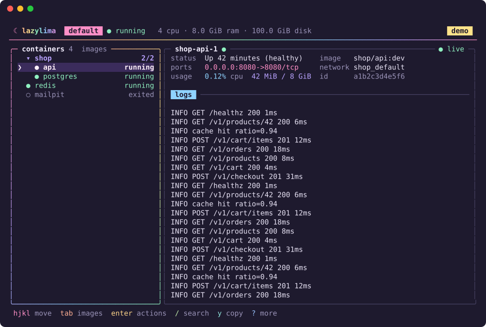

# lazylima

colima, from the comfort of your terminal. opinionated fork of [colimui](https://github.com/leodeim/colimui).



- profiles
- containers, compose stacks
- searchable logs
- shell

needs macOS, Colima 0.8.2 or later, and Docker CLI.

install:

```sh
curl -fsSL https://raw.githubusercontent.com/tokudayo/lazylima/main/install.sh | sh
```

then just:

```sh
lazylima
```

`lazylima --demo` if you want to poke around first.


| key | does the thing |
| --- | --- |
| `?` | all the actions. start here if lost |
| `hjkl` / arrows | get around |
| `enter` | expand a stack / container actions |
| `s` / `x` | start / stop a container or whole stack |
| `r` / `d` | restart / delete a container |
| `tab` | containers ↔ images (from the list) |
| `p` / `n` | pick / create a profile |
| `/` | find stuff |
| `e` | shell into a container |
| `f` / `y` | pause logs / copy |
| `o` | operation output |
| `esc` | back out |
| `q` | enough for today |

had enough? uninstall with:

```sh
curl -fsSL https://raw.githubusercontent.com/tokudayo/lazylima/main/uninstall.sh | sh
```

